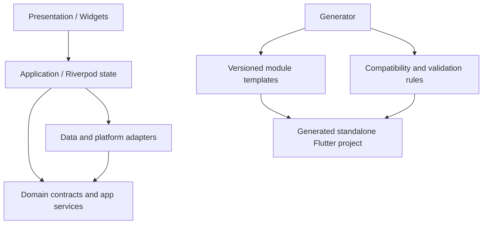

# Flutter Android App Template — Product & Engineering Roadmap

**Roadmap:** `v0.1.0` → `v1.0.0`  
**Research snapshot:** 18 October 2026  
**Status:** Proposed product and implementation plan; package versions and Android policies must be revalidated at implementation time.  
**Product shape:** A GitHub template repository with a working blank starter and a bundled project generator.  
**Primary target:** Android-first Flutter applications, while keeping the shared app architecture portable to iOS where packages and native capabilities allow it.

---

## 1. Executive summary

Build a reusable Flutter application foundation that makes the repetitive, failure-prone work of starting and hardening an app substantially easier. A developer should be able to select a clean starter or assemble a tailored app containing only the modules needed for that product—without inheriting an enormous example application or a pile of unused dependencies.

The repository should be useful in two ways:

1. **Use or fork the GitHub template:** the repository itself is a small, runnable, well-tested Flutter app with a blank-first baseline and clear setup instructions.
2. **Generate a tailored application:** a bundled Dart CLI asks for project identity, preset, platforms, backend and optional modules, validates compatibility, then writes a new project. The generated application is independent of the generator and has no runtime dependency on the template repository.

The key differentiator should not be the number of features in a README. It should be **the quality of integration**: selected modules are registered correctly, conflicting choices are rejected, unselected modules leave no dead code or dependencies, each generated combination is tested, and every feature explains its platform limits and security assumptions.

### Product promise

> Start with a blank, clean Flutter app—or generate the foundations your app needs. Spend your time on the product, not rebuilding authentication plumbing, navigation, app infrastructure, accessibility basics, diagnostics, offline persistence, and release automation from scratch.

### Non-goals

- Do not promise that any template makes an app automatically production-secure, legally compliant, or suitable for every threat model.
- Do not include every module in every generated app.
- Do not build a universal backend, payment processor, analytics platform, or cloud service.
- Do not claim Android will run arbitrary work exactly on schedule or keep arbitrary tasks alive indefinitely.
- Do not implement remote Dart/Flutter code execution as an app-update mechanism.
- Do not treat secrets placed in a Flutter bundle, `.env` file, obfuscated constant, or APK as truly secret.
- Do not make a Flutter starter dependent on proprietary services just to launch its blank screen.
- Do not build a framework within a framework. Prefer ordinary Dart/Flutter conventions and thin, documented abstractions.

---

## 2. Requirements and default decisions

These choices reflect the product requirements agreed for this roadmap.

| Area | Decision |
|---|---|
| Distribution | GitHub template repository, usable directly or forked; generator is bundled in the same repository. |
| Audience | Beginners through experienced developers. Beginner documentation must not obscure advanced customization. |
| Platform | Android-first; keep platform-independent Dart code and provider contracts portable to iOS when feasible. |
| Architecture | One documented recommended architecture, applied consistently. Avoid multiple competing architectures in v1.0.0. |
| State management | Riverpod is the leading candidate. Validate current stable APIs and trade-offs in an ADR before locking the implementation. |
| Module installation | Generation-time selection. Selected code and dependencies are included; unselected modules are omitted. |
| Blank app | Minimal runnable application plus tests, linting, configuration, and clean architecture foundations. |
| Backends | Multiple selectable integrations behind provider-specific adapters and common contracts. |
| Security | Production-oriented baseline, threat-model guidance, automated checks, privacy controls, and documented server-side responsibilities. |
| Android-native features | Native Kotlin/Gradle integrations are allowed where Flutter plugins cannot reasonably provide the required behavior; isolate them behind platform adapters. |
| Updates | Distinguish app-update UX from maintaining/updating the template in generated projects. |
| UX | Polished, neutral, customizable design tokens, reusable components, animations, reduced-motion handling, and robust loading/error/empty states. |
| Quality | Release-grade verification: unit, widget, integration, generator, device, performance, accessibility, and security checks. |
| Dependencies | Prefer mature, actively maintained packages, but evaluate maintenance, compatibility, license, and transitive dependency costs rather than popularity alone. |
| v1.0.0 definition | Thoroughly tested and documented; reproducible setup/builds; explicit module compatibility; upgrade guidance; and a defined maintenance policy. |

### Decisions to record before implementation

Use Architecture Decision Records (ADRs) for at least:

- `ADR-001`: Riverpod vs BLoC/Provider; choose one default and state why.
- `ADR-002`: Mason-based code generation vs a small custom renderer; prove generation can be tested and safely compose modules before committing.
- `ADR-003`: Routing package and route-registration model.
- `ADR-004`: HTTP client, typed error/result model, retry policy, cache policy, and token-refresh serialization.
- `ADR-005`: local database and migration approach.
- `ADR-006`: supported auth/backend adapters and their capability differences.
- `ADR-007`: logging, crash-reporting, and analytics adapters plus their privacy defaults.
- `ADR-008`: Android minimum SDK and native build-tool support matrix.
- `ADR-009`: template update strategy for already-generated applications.

An ADR is a record of an evaluated decision, not a reason to delay obvious work. Where the default choice is already well-supported, perform a focused proof of concept and record the result.

---

## 3. Analysis of established templates and tools

Popularity metrics below are a **snapshot**, not proof of correctness or actual production usage. GitHub stars, forks, pub.dev downloads, issue health, release cadence, and code quality all measure different things. Re-check each project at implementation time.

### 3.1 Reference projects

| Project | What is valuable | What to extract for this template | Limitations / caution |
|---|---|---|---|
| [Flutter samples](https://github.com/flutter/samples) | Official runnable examples; examples are intended to demonstrate focused practices with minimal side effects. The repository showed roughly 19.3k stars in this research snapshot. | Small, focused, runnable examples and clear separation between quickstarts and complete demos. Treat official examples as a way to verify platform APIs. | It is a sample collection, not a configurable all-purpose production generator. Do not copy samples blindly without checking their present status and fit. |
| [Very Good CLI](https://github.com/VeryGoodOpenSource/very_good_cli) | Established Dart CLI with project creation, test workflows, and a template system based on Mason. Roughly 2.4k stars in this snapshot. | Predictable CLI commands, helpful errors, testable process abstractions, end-to-end generation tests, release automation, strong linting, and explicit template selection. | It provides general project tooling; it does not automatically solve this product’s module-compatibility graph or security integration. |
| [Very Good Templates](https://github.com/VeryGoodOpenSource/very_good_templates) | A maintained collection of typed template families with shared development conventions; roughly 175 stars at the time checked. | Separate reusable bricks/templates, shared standards, contribution guidance, template-specific tests, and clear package-level boundaries. | Use it as a process/tooling reference, not a claim that every included template is the best fit for this product. |
| [Mason](https://github.com/felangel/mason) | Reusable project “bricks” and code-generation workflows; roughly 1.1k stars in this snapshot. | Prefer composable templates with declared inputs rather than fragile global text replacement. Use generators to make choices explicit and repeatable. | Test the exact composition and file-editing approach. Do not assume a brick-based design alone prevents invalid combinations. |
| [momshaddinury/flutter_template](https://github.com/momshaddinury/flutter_template) | A concrete starter combining Clean Architecture, Riverpod, go_router, auth, theming, and a Dio/Retrofit-style network stack; roughly 164 stars at the time checked. | A useful reference for the ordinary expectations of a modern starter: clear layers, auth examples, routing, network plumbing, and theme foundations. | A feature-rich starter is not the same as a generator that excludes unused dependencies. Treat package choices and implementation details as candidates, not unquestioned defaults. |
| [dinkar1708/flutter_riverpod_template](https://github.com/dinkar1708/flutter_riverpod_template) | Demonstrates a Riverpod 3-oriented structure, feature-based organization, secure storage, environment setup, localization, and unit/widget/E2E testing examples. | Evaluate a full quality workflow instead of only app source code; include automated UI flows where maintenance cost is justified. | Its stated dependency versions and its chosen tools are point-in-time decisions; revalidate compatibility and current maintenance. |
| [kido-luci/flutter-starter-template](https://github.com/kido-luci/flutter-starter-template) | A newer modular starter with a companion CLI for feature scaffolding and wiring. The documented approach uses explicit generator markers rather than trying to infer and rewrite arbitrary Dart files. | Keep generator changes constrained to stable, explicit registration points; test that a generated feature compiles immediately. | Newer or lower-adoption projects are useful design ideas but need deeper code, issue, license, and maintenance review before adoption. |

### 3.2 Your existing templates: patterns to carry forward

References: [wpf-11-app-template](https://github.com/Fettah010/wpf-11-app-template), [winui-3-easy-template](https://github.com/Fettah010/winui-3-easy-template), [WPF roadmap](https://github.com/Fettah010/wpf-11-app-template/blob/main/WPF-11-App-Template-Roadmap-1.0-to-2.0.md), and [WPF agent execution protocol](https://github.com/Fettah010/wpf-11-app-template/blob/main/WPF-AGENT-EXECUTION-PROTOCOL.md).

The repositories already establish useful standards:

- **Presets, rather than a single giant default:** WPF’s clean/recommended/full model is directly relevant. Keep a blank option first and make feature-rich setups intentional.
- **A real runnable app:** the WinUI template is designed as an actual app foundation with a shell, settings, diagnostics, services, localization, and release plumbing—not just a collection of disconnected snippets.
- **Optional infrastructure:** logging, persistence, updates, and other services should not be forced on users who do not need them.
- **A coherent visual foundation:** design tokens, reusable controls, themes, motion, and accessibility should be part of the quality of the product, not decorative extras added at the end.
- **Documentation as an engineering artifact:** the WPF repo has a canonical roadmap and an agent execution protocol. The Flutter repository should similarly separate the *what/why/version order* (roadmap) from the *how to execute a milestone safely* (contributor/agent instructions).
- **Release gates and validation scripts:** build/test/smoke checks should be repeatable and easy to run locally as well as in CI.
- **Stable public generator flags:** once people automate the CLI, do not rename or silently repurpose released flags. Add new options compatibly or deprecate them with a migration period.

### 3.3 How the Flutter version should go further

The key improvements over a conventional starter and over the current desktop-template pattern should be:

1. **Generation correctness as a product feature.** The blank, core, preset, and optional-module outputs must be tested as actual projects—not merely tested as files or text fragments.
2. **Explicit module manifests.** Every module declares what it adds, what it requires, what conflicts with it, supported platforms, dependency changes, configuration requirements, permission effects, and tests.
3. **Provider neutrality.** The app calls a template-owned contract. Firebase, Supabase, and custom REST implementations are adapters—not competing architectural patterns.
4. **Generated output is clean.** No template runtime library, unused backend package, sample secret, disabled feature package, or generator dependency should leak into the generated app unless it is expressly selected.
5. **A capability and compatibility matrix.** The CLI explains why a combination is invalid and suggests alternatives before writing files.
6. **Android reality documented.** Work scheduling, notifications, Play in-app updates, app signing, and background execution each have their actual Android limitations documented and tested where possible.
7. **Reproducible maintenance.** Pin toolchains and lock dependencies for CI, record tested versions, provide security/dependency audit workflows, and define how generated apps consume later template improvements.
8. **Beginner-friendly, advanced-friendly documentation.** Fast setup for a beginner; architecture diagrams, extension points, ADRs, module specs, testing commands, and native-integration notes for experienced developers.

---

## 4. Product model and project-generation experience

### 4.1 Two supported workflows

**Workflow A — use the repository directly**

1. Click **Use this template** or fork the GitHub repository.
2. Follow the quickstart.
3. Run `flutter pub get`, tests, and the blank app.
4. Build the product in the existing minimal application or use the bundled generator to create a separate tailored project.

The repository’s own `lib/` should remain a useful, buildable, blank-first reference application. Generator internals and template assets live outside the app runtime imports.

**Workflow B — generate a tailored project**

1. Run the Dart CLI bundled in the repository.
2. Enter app name, Dart package name, organization/application ID, output path, platform targets, preset, backend choices, and modules.
3. Review a summary of selected modules, added permissions, native changes, and dependency footprint.
4. The generator validates module requirements/conflicts before writing.
5. It writes a new independent project, runs formatting and static generation where supported, resolves dependencies (unless `--no-pub` is specified), and reports any required manual setup.
6. The generated project’s first validation command must pass on a clean machine.

### 4.2 Presets

All presets are aliases for an explicit, versioned module set. Presets must not be hidden bundles of magic behavior.

| Preset | Intended result | Include by default |
|---|---|---|
| **Blank** | Smallest sensible starting app | Entry point, minimal app root, basic theme tokens, configuration pattern, linting, unit/widget test scaffolding, CI quality basics. No auth, HTTP client, database, analytics, crash SDK, cart, background work, or remote backend. |
| **Core** | A structured app foundation for a growing product | Recommended architecture, Riverpod decision, route infrastructure, environment/flavor pattern, error boundary, design tokens, baseline logging interface, representative tests. Backend and persistence remain selectable. |
| **Recommended** | A typical networked app foundation | Core + selected HTTP/error/diagnostic plumbing, secure-storage abstraction, localization scaffold, and app lifecycle hooks. A concrete auth/backend provider is chosen explicitly rather than guessed. |
| **Commerce** | A commerce-oriented foundation | Recommended + product/catalog and cart example, local cart persistence, checkout contract/example, and integration-test examples. No real payment processor or backend is silently assumed. |
| **Full** | A demonstration of all compatible capabilities | All modules that can coexist under the selected platforms/backend, plus sample screens and extended test workflows. Conflicting provider choices still require an explicit choice. |

The generator must print the actual module list after expanding a preset. Users can add or remove modules interactively or by command flags.

### 4.3 Proposed CLI surface

The command names below are proposals. Keep the command surface small, consistent, and testable; freeze released behavior after it enters a stable version.

```text
ftemplate create
ftemplate create --name MyApp --org com.example --preset blank
ftemplate create --name ShopApp --org com.example --preset recommended \
  --backend supabase --module auth,networking,storage,localization
ftemplate list-modules
ftemplate explain-module background
ftemplate validate --manifest path/to/template.yaml
ftemplate doctor
ftemplate version
ftemplate update-guide
```

Expected options:

- `--name`: human-facing application name.
- `--project-name`: valid Dart package identifier (normalize cautiously; explain any transformation).
- `--org`: reverse-domain organization used for platform identifiers, after validation.
- `--output`: destination directory.
- `--preset`: `blank`, `core`, `recommended`, `commerce`, or `full`.
- `--platforms`: at minimum `android`; optionally add `ios` where selected modules support it.
- `--backend`: `none`, `rest`, `firebase`, or `supabase`, with a documented separation between auth, data, messaging, and analytics capabilities.
- `--module` / `--without-module`: explicit module additions/removals.
- `--dry-run`: display the planned files, dependencies, permissions, and native modifications without writing.
- `--yes`: non-interactive mode; it must not skip validation.
- `--no-pub`: skip dependency resolution.
- `--force`: only overwrite a non-empty destination after a clear, explicit confirmation or documented non-interactive rule.

`doctor` checks prerequisites and environment health; it should not quietly alter the machine. The CLI must produce actionable error messages and non-zero exit codes for invalid input, invalid module sets, failed generation, and failed validation.

### 4.4 Generator principles

- Prefer a **Dart CLI using Mason-style reusable bricks/templates** unless the early proof of concept reveals an important blocker. Keep a thin first-party wrapper for interactive selection, validation, presets, and diagnostics.
- The generator is a development tool; generated apps do not depend on it at runtime.
- Make generation deterministic for the same template version, options, and toolchain.
- Never mutate unrelated files in arbitrary ways. Use explicit generated registration files or clearly marked integration points.
- Do not use broad regular expressions to rewrite Dart source. Use templates for known files and bounded, tested insertion points only where necessary.
- Validate project names, paths, package IDs, and selections before writing.
- Write into a temporary destination first, validate the output, then move into place when safe; do not leave a half-generated destination silently.
- Include a machine-readable summary of selected modules, module versions, template version, SDK constraints, and required native setup in the output.
- A generated app should not include the generator source unless the user chooses a maintainer/developer option.
- Avoid running network-dependent or destructive operations without clear output. Report exactly which commands were executed.
- Make Windows paths and PowerShell usage first-class, while also testing macOS/Linux. The CLI should use `package:path` and process APIs rather than assuming `/` separators or shell semantics.

---

## 5. Architecture proposal

### 5.1 Recommended shape

Use a **feature-first structure with lightweight layers**, rather than forcing every small feature through excessive interfaces. UI, application/state, domain contracts, and data implementations must be distinguishable; introduce a domain layer when business rules or more than one implementation justify it.

```text
lib/
  main.dart
  bootstrap/
    bootstrap.dart
    app_config.dart
    app_environment.dart
    error_reporting.dart        # only when selected
  app/
    app.dart
    app_router.dart             # only when routing is selected
    app_theme.dart
    app_lifecycle.dart
  core/
    config/
    errors/
    logging/                    # core interface; adapter only when selected
    result/
    platform/
    widgets/
  features/
    <feature>/
      presentation/
      application/              # state/controllers/use-cases as appropriate
      domain/                   # entities/contracts when useful
      data/                     # repositories and provider adapters
  l10n/                         # only when localization is selected
  generated/                    # build output, ignored or committed per tool policy

test/
  unit/
  widget/
  fixtures/
integration_test/
android/
ios/                            # when iOS is generated/enabled
```

The exact directories should reflect the final architecture decision and remain consistent. Do not create empty layers solely to make the tree look “Clean Architecture.” A tiny blank app should still be tiny.

### 5.2 Dependency direction



UI should not call raw HTTP clients, secure storage, or database APIs directly. Provider-specific SDKs stay behind adapter implementations. Application-facing APIs should use app-owned models/errors/results rather than expose a provider SDK’s types throughout the codebase.

### 5.3 State management and navigation

- Evaluate the latest stable Riverpod release and select it as the default if the proof of concept validates asynchronous state, test overrides, scoped dependencies, app lifecycle integration, and generated projects.
- Use Riverpod consistently; do not include BLoC and Provider as second- and third-class alternatives in v1.0.0.
- Prefer `go_router` for declarative routing and deep links, subject to the current SDK/API compatibility review.
- Route redirects must not become the only security control. The backend still authorizes protected data and actions.
- Authentication-aware routing must handle loading/unknown session state, expired sessions, logout, deep links, and avoiding redirect loops.
- The blank preset may omit routing entirely if the minimal-output test shows that it creates unnecessary weight or concepts; the core/recommended presets include it.

### 5.4 Networking and error handling

- Evaluate Dio as the default HTTP transport. Use a typed API/error layer that hides transport-specific response details from features.
- Define timeouts, cancellation, request IDs, safe log redaction, and retry behavior explicitly.
- Retry only appropriate idempotent requests by default. Do not automatically replay non-idempotent checkout/payment operations unless the API has idempotency keys and the behavior is designed.
- Token refresh must be concurrency-safe: concurrent expired-token requests should not start many refresh requests or retry in a loop. Define logout behavior when refresh fails.
- Avoid caching authenticated or sensitive responses without an explicit policy. A cache must state expiration, invalidation, offline behavior, and what is safe to persist.
- Use a predictable result/error contract such as typed success/failure values or well-defined exceptions; avoid a maze of wrapper abstractions.

### 5.5 Environments and build variants

Provide dev/staging/production conventions, but keep the blank app simple. Configuration must be typed, validated at startup, and separated from feature logic.

- Environment-specific values are for endpoints, feature flags, public project IDs, and other non-secret configuration.
- Never ship server credentials, signing passwords, service-account keys, private API keys, or privileged tokens in the app bundle.
- Do not describe obfuscation or generated constants as a secret vault.
- Keep Android application IDs, app display names, icons, signing, version codes, and build variants explicit and documented.
- CI should use dummy/public configuration suitable for tests; production credentials are injected through protected environment/secret stores outside the repository.

---

## 6. Module catalogue and contracts

All feature modules are generation-time optional. A module has a stable identifier, dependencies, conflicts, supported platforms, required permissions, generated files, added packages, configuration instructions, and a test plan.

### 6.1 Core and developer infrastructure

| Module | Delivered behavior | Acceptance requirement |
|---|---|---|
| `architecture-core` | App bootstrap, error boundaries, configuration contract, project conventions, test structure | Blank/core app compiles with no backend or service dependency. |
| `state-riverpod` | Riverpod setup, provider organization, test overrides, lifecycle patterns | Example asynchronous state, error/loading/data states, and provider-level tests. |
| `navigation` | Declarative routes, typed route helpers where practical, deep-link examples, guarded destinations | Cold-start deep link, nested navigation, unknown route, and auth-state transitions are tested. |
| `design-system` | Color/spacing/type/shape/elevation tokens, light/dark themes, component examples | No hard-coded one-off theme values in showcase components; contrast and text scaling tested. |
| `logging` | Structured logs, severity, category/request context, debug-only verbosity, redaction helpers | Secrets, tokens, passwords, auth headers, and sensitive payloads are redacted by default. |
| `diagnostics` | Error capture interface, user-consented diagnostic sharing where relevant, crash-reporting adapter hooks | No provider SDK or outbound telemetry in blank preset; disabled/consent state is tested. |
| `analytics` | Optional event interface and provider adapter(s) | Disabled by default unless the app explicitly selects/configures it; document data collected and consent obligations. |
| `configuration` | Typed environment configuration and validation | Missing/invalid required config fails with a clear, actionable message, not an obscure null error. |
| `quality-tooling` | Formatting, analysis, tests, CI, issue/security templates and release checks | One documented local quality command produces a non-zero exit code if a required check fails. |

### 6.2 Authentication and identity

The template should provide a provider-neutral auth contract and at least the following selectable implementation paths by `v1.0.0`:

- **`auth-rest`**: integration-ready REST/JWT adapter with endpoints and payload shapes configurable through explicit interfaces/configuration; no fake universal auth server is bundled.
- **`auth-firebase`**: Firebase Authentication adapter where supported by selected features and native config.
- **`auth-supabase`**: Supabase Auth adapter with documented key/project configuration.

Auth module capabilities should include login, registration where supported, logout, password reset/recovery where supported, auth-state stream, session restoration, expiry handling, token refresh where the provider uses it, and route integration where routing is selected. Social sign-in methods should be opt-in subfeatures because each requires provider-console setup and platform-specific configuration.

Rules:

- Do not assume all providers support the same operations. The generator should communicate missing capabilities, not pretend every adapter is identical.
- Do not write a home-grown cryptographic protocol or invent token storage/refresh semantics that conflict with a provider SDK.
- Access tokens, refresh tokens, and session secrets belong in appropriate secure storage/session APIs; do not log them.
- Logout clears local state and sensitive local caches according to a documented policy.
- Server-side authorization, account recovery, rate limiting, MFA policy, and session revocation are backend responsibilities.
- Auth forms need validation, busy, success, failure, offline, and recovery states; UI must not treat local form validation as server security.
- Test expired, revoked, malformed, and missing-session behavior with fakes and provider-specific integration tests where available.

### 6.3 Networking and backend choices

| Choice | Intended use | Notes |
|---|---|---|
| `backend-none` | Blank/local app | No remote SDK or API dependency. |
| `backend-rest` | Custom backend | Typed client, error mapping, timeouts, cancellation, optional auth middleware, and generated/configured base URL. |
| `backend-firebase` | Firebase services | Each Firebase capability (Auth, Crashlytics, Messaging, Analytics, Database) is selected independently when technically possible. Do not add the entire Firebase surface because one Firebase package is selected. |
| `backend-supabase` | Supabase services | Separate auth, data, storage, realtime, and analytics considerations; do not silently select all of them. |

Backend selection is not always identical to auth selection: for example, an app can consume a custom REST API while using a third-party identity provider. The generator must represent these decisions clearly instead of using one overloaded `backend` flag.

### 6.4 Local persistence, offline operation, and synchronization

- Provide lightweight preferences for non-sensitive settings only.
- Provide secure key-value storage via a maintained secure-storage plugin when selected.
- Evaluate Drift/SQLite for relational offline data and migrations. Do not force a database into the blank preset.
- Add an explicit repository abstraction between the UI and local/remote data, with an offline-first reference feature demonstrating the chosen synchronization strategy.
- Separate caching from authoritative persistence.
- Include database migration/versioning examples and tests for upgrading a previous schema.
- Define offline states explicitly: pending write, synced, retrying, failed/conflicted, and stale data. Do not claim “offline sync” when the sample merely stores cached GET responses.
- A sample sync implementation must document its conflict policy (for example server-authoritative, last-write-wins with timestamp caveats, or explicit conflict UI). Do not invent a generic conflict resolver that silently loses user data.
- Avoid persisting auth secrets or highly sensitive data in the ordinary local database by default.

### 6.5 Commerce: catalog, cart, and checkout foundations

Include an example catalog and cart module to speed up common commerce UI, without implying that it is a complete business backend.

- Product list/detail models and example data adapter.
- Cart state management, quantity changes, remove item, totals, loading/empty/error states, and persistence adapter if storage is selected.
- Currency and locale-aware formatting; avoid assuming one currency or locale.
- Checkout interface that delegates pricing, inventory, taxes, discounts, shipping, and order creation to a trusted server.
- Test price/quantity/totals edge cases, empty cart, duplicate items, unavailable inventory, and failed checkout.
- No live payment SDK is included in the default commerce feature. Add a payment provider only as a separately reviewed adapter. Never store raw payment-card data in the template’s local app state or log it.

### 6.6 Android platform capabilities

| Module | Scope | Important constraints |
|---|---|---|
| `background-work` | Scheduled/deferrable tasks, retry/backoff, connectivity constraints, work status | Use Android WorkManager through a maintained Flutter integration where it fits. Android controls execution timing; periodic or deferrable work is not an exact alarm. |
| `push-notifications` | Push provider adapter, notification channels, foreground/background/opened-app flows, permission prompts | Messaging needs project/provider setup. Android 13+ notification permission must be requested in context; do not prompt automatically at first launch without an explanation. Test denied permission and notification-tap deep links. |
| `local-notifications` | Local notifications and channels where the selected package supports target OS | Explain Android channel behavior, permission changes, exact-alarm restrictions, OEM/battery variations, and platform-specific setup. |
| `app-updates-android` | Version/update check interface and Google Play in-app update adapter | Play in-app updates require appropriate Play distribution/testing conditions and are not a generic update mechanism for sideloaded APKs. Provide a graceful “open store/update instructions” fallback when unsupported. |
| `native-android-bridge` | Small, documented Kotlin/Gradle integration for features requiring platform code | Keep code under `android/`; document channel/platform interfaces; tests must cover failure and unsupported platform behavior. Avoid arbitrary permissions and custom native code when a maintained plugin suffices. |
| `app-lifecycle` | Resume/pause/foreground transitions and service reinitialization hooks | Do not assume app-process lifetime or in-memory state survives termination. |

Background-work guidance must differentiate:

- short work that should finish soon;
- deferrable, persistent background work;
- user-visible work that may require an appropriate foreground-service design;
- exact alarms that are restricted and should not be used as a generic scheduler.

The template must not promise arbitrary code will run continuously in the background, execute at an exact minute, or bypass Doze/battery policy.

### 6.7 App updates vs template updates

These are two separate modules and documentation areas.

**App updates:**

- Version-check interface and optional update prompt policy.
- Android Google Play in-app update flow only where the current official API and distribution method support it.
- Immediate vs flexible update UX, resumable/failed flow handling, and cancellation/fallback.
- Never force an update without an app/product policy and a defensible reason.
- Test through Play-supported internal testing; emulator-only tests are insufficient for a Play-backed availability claim.
- iOS gets a separate supported store-update prompt strategy if enabled; do not pretend the Android Play API works on iOS.

**Template updates:**

A GitHub template is a snapshot copied into each developer’s repository; future commits do not automatically flow into generated apps. `v1.0.0` must offer:

- a visible template-origin/version marker in generated projects;
- generated-file/module manifest metadata;
- upgrade notes per release describing safe manual changes;
- an explicit compatibility/breaking-change policy;
- a documented “compare with upstream” process;
- optional generated-file diff tooling only if it can reliably avoid overwriting user code.

Do not advertise one-click automatic merge/update for arbitrary customized repositories until there is a safe, tested migration engine. The first stable release may provide update guides and structured diffs instead of a risky updater.

### 6.8 UI, motion, localization, and accessibility

- Material 3-first design tokens, but no compulsory giant UI component framework.
- Semantic color, typography, spacing, shape, elevation, border, and motion tokens, with light/dark and optional dynamic color support if appropriate.
- Reusable button, text input, form field, app bar, list item/card, dialog, bottom sheet, snackbar/message, loading indicator, empty state, error/retry state, offline banner, and confirmation pattern.
- Consistent asynchronous states for network screens: loading, loaded, empty, error, stale/offline, and retrying.
- A motion system with subtle transition defaults, duration/easing tokens, and reduced-motion alternatives. Animations must not impede input, screen readers, or low-end devices.
- Internationalization through Flutter’s supported localization tooling (`gen-l10n`) unless the ADR identifies a compelling reason otherwise.
- Include Arabic RTL and Latin/LTR examples to verify direction-aware layouts, icons, alignment, and text overflow. Do not manually reverse every row or hard-code locale assumptions.
- Support text scaling, logical focus order, semantic labels, keyboard navigation where relevant, and high-contrast checks.
- Do not use animation for decoration when it worsens startup performance or makes the app feel slower. Measure representative screens.

---

## 7. Module manifest and compatibility system

This system is central to the value of the repository and should be designed in `v0.2.0`, not bolted on at the end.

### 7.1 Required metadata per module

Each module manifest should define at least:

```yaml
id: auth-supabase
version: 1
category: authentication
summary: Supabase authentication adapter
requires:
  - architecture-core
  - state-riverpod
  - configuration
  - secure-storage
conflictsWith:
  - auth-firebase
platforms:
  - android
  - ios
pubDependencies:
  - supabase_flutter
nativeChanges:
  android: []
  ios: [documented-config-when-needed]
permissions: []
configKeys:
  - SUPABASE_URL
  - SUPABASE_PUBLISHABLE_KEY
privacy:
  network: true
  telemetry: false
outputs:
  - lib/features/auth/data/supabase_auth_adapter.dart
requiredSetup:
  - Configure a Supabase project and supported public client key.
tests:
  unit: true
  widget: true
  integration: provider-dependent
```

This is illustrative, not a final schema. Avoid treating provider-specific examples as universal. A schema version and validator are required before modules multiply.

### 7.2 Compatibility rules

The validator must catch:

- missing required modules;
- mutually exclusive auth providers selected simultaneously, unless a supported combined setup is explicitly modeled;
- modules that require a backend but are paired with `backend-none`;
- platform-incompatible native modules;
- minimum SDK/deployment target conflicts;
- incompatible package or generator versions;
- conflicting generated filenames/routes/registrations;
- invalid environment combinations or missing mandatory configuration;
- permissions and manifest entries introduced by modules;
- modules requiring provider-console setup before their integration can be fully exercised.

Error messages should say **what conflicts, why, and how to fix it**. Example: “`app-updates-android` is Android-only. Remove it for an iOS-only project, or generate Android support too.”

### 7.3 Composition rules

- Templates should add files, dependencies, and registrations through explicit known integration points.
- Prefer generated registries (`generated_module_registry.dart`, route registry, provider registry) over silently editing arbitrary handwritten files.
- Regenerate registries deterministically and show users which files are generated.
- Every generated file has a clear ownership policy: generator-owned, developer-owned, or generated-once-and-user-editable.
- Where safe regeneration cannot be guaranteed, generate once and provide instructions rather than overwriting edits.
- Dependency additions and native-file mutations must be visible in the dry-run summary.
- Test that removing a module during generation yields no stale imports, routes, declarations, permissions, or dependencies.

### 7.4 Preventing combinatorial test explosion

Testing every possible combination of 12 or more modules may be prohibitively expensive. Use layered coverage:

1. Validate every manifest and every declared dependency/conflict edge.
2. Generate and build each module in isolation with its minimum required modules.
3. Fully test every named preset and all supported backend presets.
4. Test a documented pairwise/representative set of compatible module combinations.
5. Run a maximum-capability Android composition with every compatible module.
6. Run the blank preset separately and enforce that it contains no optional module dependencies/files.
7. Run core/platform smoke cases for Android and iOS where support is claimed.
8. Add a test case for every real compatibility bug so it cannot silently return.

The compatibility matrix, selected combinations, and gaps must be checked into the repository and published in docs.

---

## 8. Security, privacy, and operational quality

Security is a baseline, not a checkbox. The starter must establish safer defaults and explicitly state the controls that belong on the backend.

### 8.1 Minimum secure defaults

- HTTPS-only production API configuration unless a narrowly documented development-only override is used.
- No committed production secrets, service account keys, signing material, or tokens.
- Secure storage for selected session credentials, with a tested logout and clear-data flow.
- Redaction of authorization headers, refresh/access tokens, passwords, personally identifying payloads, and payment-related fields in logs.
- Defensive timeout/cancellation/error handling and bounded retries.
- No disabled certificate validation in production; no insecure trust-all TLS callback.
- Deep links validated and parsed defensively; sensitive actions still require server authorization.
- Validate external input, serialized data, and configuration boundaries.
- Minimize collection and retention of analytics/crash data; analytics disabled unless explicitly configured and required consent/notice is handled by the app owner.
- Clear separation of debug logs and production telemetry; do not print raw objects that may contain secrets.
- Dependency audit and license review before release; automated detection of known vulnerable dependencies and accidental secrets.
- Explicit Android permissions and privacy disclosures; no unused permissions added by default.
- Release builds use documented signing practice; keystore/password files are never checked in.
- Threat-model guide asks about data sensitivity, authentication, local compromise, deep links, exported components, backup rules, device integrity, and backend abuse as relevant.

### 8.2 Threat model and security boundaries

Create a starter threat model that is useful but not presented as certification. It should identify:

- untrusted device and client-side inputs;
- source/package/secret leakage;
- token theft or accidental logging;
- insecure local persistence and backup exposure;
- auth/session and deep-link abuse;
- transport/network misuse;
- malicious or vulnerable dependencies;
- over-privileged Android manifest entries;
- abuse of backend endpoints and insufficient server-side authorization;
- privacy/consent failures introduced by analytics and crash reporting.

Use the current [OWASP MASVS](https://mas.owasp.org/MASVS/) and [OWASP mobile testing guidance](https://mas.owasp.org/) as references. Map the relevant checklist items to the generated app’s threat model and validation steps; do not claim full MASVS compliance just because the checklist is present.

### 8.3 CI security gates

At minimum, automate:

- secret scanning on changed files and repository history where available;
- dependency vulnerability checks using an actively maintained scanner;
- lockfile and dependency review;
- static analysis and formatting;
- license inventory for included dependencies;
- Android manifest/permission diff review for native modules;
- release artifact generation and signature/configuration checks where CI can safely validate them;
- a documented manual review for provider-console configuration, app privacy disclosures, Play Console forms, and signing custody.

Do not mark a release safe solely because a scanner passed. Known false positives and accepted risks must be documented with rationale, owner, and review date.

### 8.4 Privacy by default

- Blank: zero network calls, zero analytics/crash reporting, and zero background tasks beyond Flutter/platform defaults.
- Optional provider modules must declare what data they send and when.
- No telemetry without explicit configuration and clear app-owner policy. Consent UX is generated only where it makes sense for the chosen service and applicable policy; avoid a generic consent dialog that does not identify real data collection.
- Sample data is fake and contains no real personal information.
- Logs and bug-report exports must be redacted and user-initiated when they contain diagnostic details.

---

## 9. Testing and verification strategy

The template must test not only the application modules but also the system that creates them.

### 9.1 Test layers

| Layer | Required coverage |
|---|---|
| Unit | Domain rules, value parsing, config validation, typed error mapping, retry eligibility, cart totals, sync/conflict behavior, auth state transitions, generator validators. |
| Widget | Forms, loading/error/empty states, theming, accessible labels, validation feedback, cart controls, auth screens, route guard states. |
| Provider/adapter | Fakes for auth, API, storage, clocks, notifications, background status, and update availability; provider-specific tests where practical. |
| Generator | CLI argument parsing, interactive/non-interactive choices, invalid combinations, output paths, safe overwrite, errors, dry-run, deterministic output and manifest handling. |
| Generated-project | `pub get`, formatter, analyzer, code generation if selected, unit/widget tests and release compile for every named preset. |
| Integration | Critical journeys such as login/logout/session restoration, deep-link routing, offline/online data, cart/checkout failure, notification opening a route, and update fallback. |
| Native Android | Permission denial, background task rescheduling/retry, app lifecycle, signing/build configuration, and update behavior where the Play testing environment permits. |
| Device | At least one supported low/mid-range real Android device and emulator in release-candidate verification; document OS versions and limitations. |
| iOS compatibility | At minimum generator/build smoke coverage for the shared core and declared cross-platform modules before claiming iOS support. |
| Performance | Build size, startup, frame jank, memory, and representative screen performance compared against a recorded baseline. |
| Security | Dependency scan, secret scan, permission review, log-redaction tests, auth/session failure tests, and threat-model review. |
| Accessibility/i18n | Text scaling, semantics, RTL layouts, long translated strings, contrast, focus order, reduced motion, and notification permission UX. |

### 9.2 Required local commands

Names can be adjusted, but the repository should expose a small set of scripts or commands that produce truthful exit codes:

```text
format check
static analysis
unit + widget tests
module manifest validation
generator unit/e2e tests
preset generation matrix
Android debug build
Android release/AAB build (with safe dummy signing/config where possible)
security/dependency checks
release verification
```

A single `tool/verify.*` wrapper may call these on Windows, macOS, and Linux, but it must print every command and propagate failures. Do not hide failures behind a final successful echo. Keep expensive device/Play Console tests in a documented release workflow if they cannot run on every pull request.

### 9.3 Release gate policy

- A required check failing means the release is blocked.
- No release tag or “stable” claim until the whole gate passes for the exact commit.
- Do not commit generated secrets, local SDK paths, Android signing files, or machine-specific configuration.
- Use a clean CI checkout for reproducibility checks.
- Preserve test logs and generated-project test summaries as CI artifacts.
- Every accepted test exception must be explicit, scoped, and dated; avoid blanket `continue-on-error` on important jobs.
- Do not silently lower checks to get a green build. Fix the issue or revise the documented acceptance criterion before merge.

### 9.4 Performance and size policy

Avoid arbitrary cross-device promises such as a universal startup time or APK size. Instead:

1. Establish a release-mode baseline on named emulator/device configurations.
2. Measure blank, core, recommended, and full generated outputs independently.
3. Record app bundle size, startup to first usable frame, memory, and jank methodology.
4. Fail CI on unexplained regressions beyond a documented tolerance (start by investigating regressions above 10%; adjust only after recording why the measurement is noisy or inappropriate).
5. Ensure optional modules add no files/dependencies to outputs where they are not selected.
6. Provide relative module cost data when measurements are repeatable, rather than claiming all modules are “lightweight.”

---

## 10. Repository layout proposal

A clean initial shape could be:

```text
/
  .github/
    workflows/
    ISSUE_TEMPLATE/
    pull_request_template.md
    dependabot.yml                 # if used and configured
  android/                         # runnable blank reference app, Android-first
  ios/                             # maintained if included in the template reference app
  lib/                             # blank reference app only; avoid importing optional modules
  test/
  integration_test/
  tool/
    ftemplate_cli/
      bin/
      lib/
      test/
    verify/
  bricks/                          # reusable versioned generation templates
    core/
    state_riverpod/
    navigation/
    design_system/
    networking/
    logging/
    secure_storage/
    auth_rest/
    auth_firebase/
    auth_supabase/
    database_drift/
    offline_sync/
    commerce_cart/
    background_work/
    push_notifications/
    app_updates_android/
    localization/
    analytics/
    crash_reporting/
  manifests/
    modules/
    presets/
    schema/
  docs/
    architecture/
    adr/
    modules/
    security/
    testing/
    release/
    troubleshooting/
  scripts/
  .editorconfig
  .gitignore
  analysis_options.yaml
  pubspec.yaml
  pubspec.lock
  README.md
  CHANGELOG.md
  CONTRIBUTING.md
  CODE_OF_CONDUCT.md
  SECURITY.md
  LICENSE
  THIRD-PARTY-NOTICES.md
  ROADMAP.md
  AGENTS.md or equivalent agent/contributor protocol
```

Adjust after the generator proof of concept. Do not create empty bricks for every future idea in the first milestone. Begin with a few real, composable bricks and validate the pattern. Keep generated-app paths separate from generator source paths so that module files are easy to inspect.

### Repository documentation that must exist by v1.0.0

- `README.md`: what it is, why use it, quickstart, generated presets, screenshots only if they add real information, limitations, supported toolchain.
- `ROADMAP.md`: canonical release sequence and scope.
- `CHANGELOG.md`: user-facing changes and breaking changes.
- `CONTRIBUTING.md`: local setup, code style, branching/review expectations, tests, module authoring.
- `SECURITY.md`: report policy and security limitations.
- `THIRD-PARTY-NOTICES.md`: dependency/license notice inventory, generated and current.
- `docs/ARCHITECTURE.md`: overview, directory structure, dependency direction, diagrams.
- `docs/MODULES.md`: catalogue, flags, dependencies, conflicts, platform and setup requirements.
- `docs/COMPATIBILITY.md`: SDK/package/platform/combination matrix.
- `docs/SECURITY-BASELINE.md`: threat model and client/server boundary checklist.
- `docs/TESTING.md`: every test layer and local/CI commands.
- `docs/RELEASING.md`: release gate, versioning, tags, reproducibility, rollback/correction process.
- `docs/UPGRADING.md`: what template copies do and do not inherit; version-by-version update notes.
- `docs/DECISIONS/ADR-*.md`: key architecture and tooling decisions.
- `docs/modules/<module>.md`: setup, capabilities, limitations, test plan, provider-side steps, removal behavior.

---

## 11. Version-by-version implementation roadmap

The release numbers define scope and exit gates, not calendar estimates. Reorder work only through a documented roadmap change. Do not broaden a milestone because a package makes another feature look easy.

## `v0.1.0` — Verified blank foundation

**Outcome:** a small, clean Flutter starter that is pleasant to begin with and has a sound verification baseline. No optional product modules yet.

### Implement

- Create the repository structure and clarify that the repo’s own app is the blank reference app.
- Pin the Flutter/Dart toolchain used by CI; record platform and Java/Gradle/Android SDK expectations. Revalidate the current stable release during implementation.
- Define package naming, app naming, versioning, branch/release conventions, license, contributing and security-reporting policy.
- Implement the blank app entry point, minimal theme tokens, one example screen, and a simple configuration boundary if required.
- Add formatter, strict-but-practical static analysis, unit/widget test example, and local verification script.
- Add GitHub Actions for format/analyze/test and an Android debug/release compile smoke test that does not expose credentials.
- Add `AGENTS.md` or equivalent maintainer instructions requiring exact-scope work, verified commands, no unjustified dependencies, and no release/commit before required gates pass.
- Write the initial architecture proposal and ADR template.

### Do not implement yet

No authentication, provider SDK, HTTP stack, cart, local database, analytics, background tasks, in-app updates, or decorative app shell in the blank runtime.

### Exit criteria

- Fresh clone builds and runs with the documented toolchain.
- Format, analysis, unit/widget tests, and Android build pass from a clean checkout.
- Blank app makes no network requests and requests no unnecessary Android permissions.
- README gets a beginner from clone to first run without undocumented steps.
- CI failure returns a failing status; no check is marked successful when its underlying command failed.

## `v0.2.0` — Generator prototype and module-manifest contract

**Outcome:** a validated generation pipeline for blank/core projects and a small initial module set.

### Implement

- Build the CLI proof of concept and evaluate Mason-style bricks for composition.
- Add project name, organization ID, output path, preset, dry-run, non-interactive, and safe-overwrite handling.
- Define and validate a versioned module manifest schema.
- Add `blank` and `core` presets.
- Add initial bricks for core configuration, chosen state management, and navigation only if selected.
- Add a module dependency/conflict graph with actionable diagnostics.
- Generate into an empty/temporary destination safely; verify files before finalizing output.
- Write generation logs/summary and machine-readable template metadata into generated projects.
- Test Windows path behavior and at least one macOS/Linux CI path.

### Exit criteria

- CLI tests cover valid, invalid, missing, duplicate, conflicting and unsupported options.
- Blank generation has no optional dependencies or files.
- Core generation resolves, formats, analyzes, tests and builds from scratch.
- Repeating generation with identical inputs yields deterministic output apart from explicitly documented generated identifiers/timestamps (prefer no timestamps in generated source).
- The generator never overwrites a non-empty directory without explicit behavior.

## `v0.3.0` — Production architecture, themes, navigation and environments

**Outcome:** a stable, documented foundation for app features with consistent state, routing, layout, and configuration patterns.

### Implement

- Finalize architecture and Riverpod ADR after a short validation prototype.
- Add app bootstrap and predictable provider/container setup.
- Add `go_router` or the ADR-selected routing package with deep-link examples and optional auth-guard extension points.
- Build the neutral design-token/theme foundation, including light/dark themes and reusable core widgets.
- Define environment/flavor configuration and build identity conventions.
- Add a feature example demonstrating how to place presentation/state/domain/data code without over-layering simple features.
- Make route, provider, and module registrations generator-controlled and testable.
- Add component showcase/example screens to a separate demo preset, not to the blank app.

### Exit criteria

- Generated core projects share one architecture and naming convention.
- Deep-link and unknown-route tests pass.
- Theme tests cover brightness, text scaling, and key semantic colors.
- Invalid configuration fails clearly and does not leak environment data into logs.
- Blank, core and demo outputs are separate and documented.

## `v0.4.0` — Networking, diagnostics, logging and secure-storage baseline

**Outcome:** networked applications gain reliable infrastructure without leaking transport details or secrets into the UI.

### Implement

- Add Dio or the ADR-selected HTTP client behind a typed networking layer.
- Add timeout, cancellation, request correlation, error mapping, bounded idempotent retry, and safe interceptor patterns.
- Add redacted structured logging with debug/release policy.
- Add secure key-value storage behind a small interface, using a maintained plugin and documenting minimum platform requirements.
- Add app-owned error reporting interfaces; keep actual crash/analytics providers optional and separately selectable.
- Add dependency/license inventory, lockfile policy, secret scanning, and vulnerability checks in CI.
- Add tests for timeouts, malformed responses, cancellation, redaction, retry exhaustion, and absence of network/logging side effects in blank outputs.

### Exit criteria

- No token or sensitive header appears in logs across regression tests.
- Blank/core projects do not inherit networking, secure-storage, or telemetry dependencies unless included by preset.
- A fake HTTP adapter supports deterministic tests without live services.
- Retry rules and cache semantics are documented and covered by tests.
- CI scan findings are triaged; known exceptions have written rationale and review date.

## `v0.5.0` — Authentication and backend adapters

**Outcome:** developers can choose a supported identity/backend approach without changing the app’s feature-facing contracts.

### Implement

- Add provider-neutral auth/session contracts and a tested auth state model.
- Add the custom REST/JWT adapter.
- Add Firebase Auth and Supabase Auth adapters as independently selected modules after verifying current APIs, native setup, licenses, and maintenance.
- Add optional password recovery and social sign-in subfeatures only where the provider path can be tested/documented correctly.
- Add session restoration, secure persistence, token refresh where applicable, logout, error mapping, and router integration.
- Add backend capability descriptors and explicit generator errors where providers differ.
- Add provider configuration guides and safe placeholder configuration files; no real keys or credentials.

### Exit criteria

- Each adapter passes contract tests for implemented capabilities.
- Concurrent token-expiry tests prove refresh is serialized and does not loop indefinitely.
- Expired/revoked/missing session, failed login, offline state, logout, and protected deep-link transitions are tested.
- Provider setup steps are clear for a first-time developer.
- No backend or auth SDK appears in blank output; only chosen adapters appear in generated projects.

## `v0.6.0` — Persistence, offline patterns, synchronization and commerce foundation

**Outcome:** apps can add durable local data and a meaningful offline-oriented feature without conflating cache, local storage, and server authority.

### Implement

- Add non-sensitive preferences module.
- Add a relational local database adapter (evaluate Drift/SQLite) with migrations and test database support.
- Add repository patterns for local/remote data and a reference offline-first feature.
- Document cache TTL, invalidation, synchronization state, retry, idempotency, and conflict resolution.
- Add catalog and cart module, with local/demo data adapter and optional persistence.
- Add checkout contract and error/empty/loading states without adding a payment SDK by default.
- Add tests for migrations, data loss edge cases, offline/online transitions, conflict behavior, cart totals, and failed checkout.

### Exit criteria

- Migrations are repeatable/tested from a previous schema version.
- Offline capability is accurately documented and does not claim complete sync if only caching is implemented.
- Every sync sample declares its conflict policy.
- Checkout has no client-authoritative pricing assumption and no payment-card storage.
- Cart/storage dependencies appear only when the selected module needs them.

## `v0.7.0` — Android platform services: notifications, background work and updates

**Outcome:** the template offers carefully bounded Android features with native behavior surfaced clearly to Flutter code.

### Implement

- Add WorkManager-based deferrable task integration or its currently maintained equivalent.
- Add notification foundations with channels, permission requests, foreground/background/tap handling, and deep-link hand-off.
- Keep push messaging separate from local notifications; each provider integration is optional.
- Add Android in-app update adapter using a current compatible official Play API/plugin, with store-link fallback and clear unsupported states.
- Add the minimum Kotlin/Gradle platform bridge needed for selected capabilities; isolate it from shared Flutter logic.
- Build permission/native manifest diff reporting into generation summary.
- Document release-track requirements for testing Play-backed update behavior.

### Exit criteria

- Scheduled work tests constraints/retries and does not promise exact execution times.
- Notification flows work when permission is denied and when the app is opened through a notification.
- Android 13+ permission behavior is tested; no unnecessary prompt on first launch.
- Update module handles not-available, canceled, failed, unsupported, and success states.
- iOS generation rejects Android-only modules or provides a documented platform-specific substitute; it never silently generates broken native code.

## `v0.8.0` — Localization, accessibility, motion and polished UI states

**Outcome:** generated apps start with a consistent, adaptable user experience without turning the blank preset into a showcase application.

### Implement

- Add Flutter localization generation with at least English and Arabic sample resources; verify RTL layout. Additional languages can be sample placeholders only if fully translated and reviewed.
- Add direction-aware layout patterns, text overflow handling and locale-aware number/currency/date formatting.
- Complete core UI components: form fields, buttons, messages, empty/error/loading/offline states, confirmation patterns, list/card, dialogs and bottom sheets.
- Add theme variants and motion tokens, route transitions, reduced-motion alternatives, and performance-safe animation defaults.
- Add semantics/focus/contrast/text-scaling tests and a manual accessibility checklist.
- Move component demo/gallery into an optional showcase preset.

### Exit criteria

- RTL tests cover key screens and mixed-direction strings.
- Text scaling and accessibility semantics pass automated checks where available and manual review for high-impact flows.
- Reduced-motion preference is respected for template-owned animations.
- Loading/error/empty/offline states are consistent and testable.
- Blank output remains minimal and excludes localization/gallery assets unless chosen.

## `v0.9.0` — Integration hardening and release-grade verification

**Outcome:** all supported named presets and selected module combinations are tested as full generated projects.

### Implement

- Complete generator compatibility matrix, dependency conflict tests, pairwise combination tests, and maximum-capability composition.
- Add integration-test flows for authentication, deep links, persistence/offline transitions, cart, notifications, and update fallbacks as applicable.
- Add real-device Android smoke testing and documented emulator/device/OS matrix.
- Add performance/size baselines for blank/core/recommended/full outputs.
- Add security review against the current threat model and relevant OWASP MASVS controls.
- Verify signing/release configuration, permission declarations, privacy docs, license notices, dependency audit, and generated secrets policy.
- Add architecture diagrams, module authoring guide, troubleshooting, and a first upgrade guide from earlier generated project metadata.
- Conduct an external or independent review of the generator and the highest-risk auth/session/native areas if practical.

### Exit criteria

- Every named preset builds, analyzes, runs its tests, and has a passing generation report.
- Every module can be generated with its declared prerequisites.
- No known module conflict is silently accepted.
- Required scans and security review have no untriaged critical/high findings. Any exception requires documented risk acceptance and owner.
- Performance results and test-device details are recorded, not guessed.
- No unresolved P0/P1 defect remains in the v1.0.0 scope.

## `v0.10.0` — Release candidate and freeze

**Outcome:** feature scope is frozen; focus shifts from adding features to proving reliability and clarity.

### Implement

- Freeze generator flags, module IDs, manifest schema, and public directory conventions for the candidate.
- Run a clean-machine verification from clone to generated release build on the supported host matrix.
- Re-test every documented command exactly as written.
- Verify module manifests and compatibility docs match actual generated output.
- Audit dependency pins, SDK/toolchain constraints, package licenses, security advisories, permissions, environment configuration, app-update constraints, and third-party notices.
- Review blank app startup and module costs against captured baselines.
- Draft stable changelog/release notes and upgrade policy.
- Publish an RC with known limitations, checksum/signature where appropriate, test matrix, and feedback route.

### Exit criteria

- No feature is added during RC without explicitly restarting the release-candidate validation cycle.
- All required checks pass from a clean checkout.
- README quickstart works for a new developer without private credentials.
- No mismatch exists between preset documentation and actual output.
- Known limitations are disclosed and do not contradict the production-ready promise.

## `v1.0.0` — Stable, reusable foundation

**Outcome:** a dependable template used as a starting point for multiple commercial apps, with clear boundaries and maintenance expectations.

### Ship

- Blank, core, recommended, commerce, and full presets with documented module manifests and compatibility constraints.
- Stable bundled generator with validated inputs, dry-run, safe output handling, readable diagnostics, and deterministic output under pinned toolchains.
- Consistent feature-first architecture and the ADR-approved defaults.
- Documented optional auth/backend, networking, secure-storage, logging/diagnostics, local persistence/offline, commerce, Android background, notification, app-update, UI, localization, accessibility, and quality modules.
- Tests at unit, widget, integration, generator, native, and release-gate levels appropriate to each capability.
- Clean release builds and reproducible setup for all named presets.
- Security/privacy baseline, dependency/license inventory, threat-model guide, `SECURITY.md`, and automated scans.
- Complete docs and at least one end-to-end walkthrough from project generation to test build.
- Upgrade policy for generated projects and a visible list of breaking changes.
- Release tag, changelog, compatibility matrix, and documented maintenance policy.

### Stable definition of done

`v1.0.0` is **not** achieved because every planned file exists. It is achieved only if a new developer can generate a chosen app, understand what was included, run the tests, build an artifact, and extend the app without reverse-engineering the generator—and if maintainers can prove that every supported preset still works after changes.

---

## 12. Release-wide acceptance criteria for `v1.0.0`

Every criterion is a release blocker unless explicitly marked informational.

### Generation

- [ ] GitHub repository functions as a normal, buildable blank-first Flutter app template.
- [ ] CLI generates at least the five documented presets.
- [ ] Selected modules, dependencies, native permissions/configuration, and generated registrations match the summary.
- [ ] Unselected modules do not leave unused dependencies, imports, routes, permissions, dead files, or sample secrets.
- [ ] Invalid/conflicting selections fail before writing; errors are actionable.
- [ ] Dry-run is accurate; safe-overwrite rules are tested.
- [ ] Output is deterministic with a pinned toolchain and fixed input.
- [ ] Generated projects do not require access to the template repository at runtime.

### Application quality

- [ ] All named presets pass format, analysis, tests, dependency resolution, and Android build checks.
- [ ] The blank output launches without backend credentials or remote service configuration.
- [ ] App loading/error/empty/offline/auth states are coherent for applicable modules.
- [ ] Architecture examples use the same state-management, routing, error, and repository conventions.
- [ ] Provider-specific SDKs do not leak across app-owned contracts unnecessarily.
- [ ] Dependency versions are pinned/locked for the release and tested SDK ranges are published.

### Android/iOS compatibility

- [ ] Android min SDK, compile/target SDK, Java, Gradle, and Flutter/Dart toolchain requirements are documented and tested.
- [ ] Android-only modules cannot accidentally produce broken iOS output.
- [ ] The shared core and all modules advertised as iOS-compatible pass at least generation/build smoke tests on iOS CI or an explicitly documented supported runner.
- [ ] Permissions are added only when selected and explained in output/docs.
- [ ] Background execution and update limitations are accurately documented.

### Security and privacy

- [ ] No production secrets or signing material exists in the repository or samples.
- [ ] Secure-storage and logout/session-clearing paths are tested for supported auth adapters.
- [ ] Sensitive logs are redacted in regression tests.
- [ ] Threat model, dependency scans, license inventory and privacy defaults are documented.
- [ ] No untriaged critical/high security finding remains; exceptions require written risk acceptance.
- [ ] Blank preset sends no telemetry or app-owned network requests by default.

### Maintainer quality

- [ ] Every module has a manifest and module-specific README.
- [ ] Release process and stable-version semantics are explicit.
- [ ] Upgrade guides describe template snapshots, user changes, and breaking changes honestly.
- [ ] CI exposes test and generation-matrix results as artifacts.
- [ ] `CHANGELOG.md`, `SECURITY.md`, contribution docs, third-party notices, and supported-version policy are current.
- [ ] The exact release commit passes the full stable gate before tagging.

---

## 13. Dependency selection policy

Use a package because it solves a demonstrated problem reliably—not because it is fashionable or has the highest star count.

### Candidate defaults to evaluate

This is a shortlist for ADRs, **not a locked `pubspec.yaml`**. Versions change rapidly; check stable versions, changelogs, SDK constraints, platform support, licenses, and open security issues immediately before implementation and release.

| Capability | Candidate | Evaluation notes |
|---|---|---|
| State management | [Riverpod](https://pub.dev/packages/riverpod) / [flutter_riverpod](https://pub.dev/packages/flutter_riverpod) | User-selected leading candidate; confirm the stable API, generator complexity, test ergonomics, and current compatibility. |
| Routing | [go_router](https://pub.dev/packages/go_router) | Flutter-team-published declarative router; evaluate deep links, redirect semantics, nested navigation, and supported Flutter/Dart floor. |
| HTTP | [Dio](https://pub.dev/packages/dio) | Strong interceptors, cancellation, upload/download and timeout features. Hide it behind app-owned API types. |
| Secure storage | [flutter_secure_storage](https://pub.dev/packages/flutter_secure_storage) | Review current platform implementations, minimum Android API, migration behavior, biometric scope, and iOS configuration before selecting. |
| Local relational DB | [Drift](https://pub.dev/packages/drift) over SQLite | Strong typed queries and migrations; use only in projects selecting relational persistence. |
| Background tasks | [workmanager](https://pub.dev/packages/workmanager) / current endorsed Android implementation | Verify its currently maintained version, Android constraints, native setup and foreground-service implications. |
| Firebase auth | [firebase_auth](https://pub.dev/packages/firebase_auth) | First-party Firebase-published integration; provider setup and service capability remain explicit. |
| Supabase | [supabase_flutter](https://pub.dev/packages/supabase_flutter) | Official/client package documentation; keep publishable client config distinct from service-role secrets, which must never ship in app. |
| Android Play updates | [in_app_update](https://pub.dev/packages/in_app_update) or an actively maintained alternative | Android/Play-specific. Verify official API and plugin maintenance; provide unsupported/distribution fallback. |
| Code generation | Mason-style bricks; Dart `build_runner` only where needed | Keep generation reproducible and well tested. Avoid codegen merely to avoid a few readable lines. |
| Localization | Flutter `gen-l10n` | Prefer the official Flutter localization path unless an ADR supports another package. |
| Tests | Flutter test tooling + native/device automation selected by need | Start with built-in unit/widget/integration testing; add device automation only where reliability and maintenance justify it. |

### Package review checklist

For every dependency, record:

- ownership/publisher and official or community status;
- release cadence, latest stable release and recent commit/activity;
- compatibility with selected Flutter/Dart and Android/iOS SDKs;
- license and attribution obligations;
- issue quality, migration guide, security policy, and unresolved severe issues;
- transitive dependency count and maintenance risk;
- test strategy and failure behavior;
- module size/performance contribution where measurable;
- why the app cannot reasonably use SDK-native functionality instead;
- fallback/replacement plan if maintenance stops.

Do not upgrade to the newest version just because it exists. Upgrade by reviewed change, update locks, run the full matrix, and record migration notes. Keep application locks committed in reference/generated applications and make the supported toolchain explicit.

---

## 14. Maintenance and governance policy

### Supported toolchains

- Track Flutter stable and the matching Dart version. The research snapshot lists Flutter `3.47.0` as a current stable release, but that value is historical by the time implementation may begin; do not permanently hard-code it as an unchanging policy.
- At `v1.0.0`, state the exact primary tested Flutter/Dart versions and supported Android SDK/toolchain ranges.
- Define whether the previous Flutter stable release is a supported compatibility target. Prefer testing current stable and one prior stable if practical; otherwise publish a narrower, honest range.
- Re-evaluate SDK and package versions for security fixes and platform-policy changes at every release.
- Avoid requiring developers to install Android Studio merely to run Flutter CLI tasks where not necessary; however, Android SDK/command-line tools, JDK, Gradle and emulator/device prerequisites must be documented accurately.

### Versioning

- Use SemVer for the template/CLI release.
- Breaking CLI flags, module IDs, manifest schema, generated public contracts, default presets, or required SDK floors require a major version or a documented migration policy appropriate to pre-1.0 releases.
- Add options compatibly; do not silently redefine existing flags.
- Pin template module/schema version to the generator version. Fail safely when a manifest version is unsupported.
- Keep `CHANGELOG.md` updated and describe changes that affect already-generated projects.

### Update policy for generated apps

- Explain clearly that GitHub’s “Use this template” copies files; later upstream commits do not automatically update that copy.
- Maintain a per-release upgrade guide with affected modules, required commands, code/native changes, risk, and verification steps.
- Treat generated files according to explicit ownership categories. Do not run a broad auto-updater that overwrites user files.
- A future automated migration tool may be added only after demonstrating safe diffs and rollback on several realistic customized projects. It is not a v1.0.0 requirement.

### Maintenance cadence

- Review critical/high vulnerabilities as soon as practical and document response expectations in `SECURITY.md`.
- Review dependency freshness, SDK support, and open issue health at every release.
- Run a periodic full generation matrix even when no app feature changes, because upstream Flutter/Gradle/Android changes can break templates.
- Keep a “known issues / temporarily unsupported combinations” section current.
- Deprecate modules clearly when unmaintained or no longer compatible; do not silently drop them.

---

## 15. Execution protocol for maintainers and coding agents

The roadmap is the source of truth for **scope and release order**. A separate `AGENTS.md`/execution protocol should define how work is performed and verified without copying the whole release plan into a second competing document.

Required rules for every implementation task:

1. Read the applicable roadmap milestone, module manifest, ADRs and existing tests before editing.
2. Inspect actual repository state; do not assume a source file, package version, toolchain or test result based on documentation alone.
3. Implement only the current milestone and accepted prerequisites. Do not add unrelated features or dependencies.
4. Favor explicit small changes and readable code. Avoid giant one-file implementations, excessive abstraction, placeholder APIs, fake integrations, dead code, generic “TODO” architecture, and decorative UI that has no product purpose.
5. Make a failing test or reproducible defect visible before fixing it when practical.
6. Never weaken or delete a test, lint, analyzer rule, security gate, or compatibility rule just to obtain green CI without an explicit, documented ADR/decision.
7. Do not commit or tag until the required validation for that scope passes. If something cannot run, report the exact command and reason; do not claim it passed.
8. Run the generator matrix for any changes to module files, manifests, templates, generator behavior, package constraints, or native configuration.
9. Review the actual diff for accidental secrets, local paths, unrelated formatting, license changes, unnecessary permissions, and generated files that should not be committed.
10. Update tests, module documentation, compatibility matrix, changelog, and upgrade notes with the behavior change.
11. Keep tool output truthful. Propagate exit codes and distinguish tests not run from tests passed.
12. Before a release, validate the exact commit from a clean checkout and preserve the CI/test report.

### Anti-patterns to block in review

- Adding every package to the root `pubspec.yaml` “for convenience.”
- Claiming a client-side secret is secure because it is obfuscated or stored in an environment file.
- Making the blank app require Firebase/Supabase credentials, permissions, network connectivity, or analytics configuration.
- Coupling a feature to a provider SDK throughout the UI/application layers.
- Hiding provider capability differences behind misleading universal methods.
- Automatically retrying mutations or checkout operations without idempotency.
- Treating a cached response as offline synchronization.
- Claiming background jobs are exact or guaranteed to run on schedule.
- Claiming app updates work outside the distribution/channel required by the platform API.
- Broad regex-based rewriting of Dart/Gradle/manifest files.
- Automatic overwriting of user-authored code by generator updates.
- Giant generated demo pages in the default preset.
- Over-animated UI, gradients/shadows everywhere, low-contrast text, arbitrary spacing, tiny tap targets, or animations that ignore reduced motion.
- Adding a native permission before identifying its feature owner and documenting why it is needed.
- Hard-coding Android-only APIs into common Dart paths without a platform guard or adapter.
- A “full” preset that cannot compile cleanly or contains placeholder integrations presented as finished.
- Marking a release `stable` with known untriaged severe security problems or failing validation.

---

## 16. Key risks and mitigations

| Risk | Why it matters | Mitigation |
|---|---|---|
| Scope explosion | Auth, offline sync, cart, background work, updates, and multiple backends are separate engineering problems. | Deliver in bounded versions; preserve explicit contracts and acceptance criteria; avoid feature additions during RC. |
| Dependency churn | Flutter packages, Gradle, Android SDK policies, and plugins change independently. | Lock versions, record support matrix, review changelogs/security, run the generation matrix regularly. |
| Generator fragility | Template edits can create broken imports, native manifests, or dependency conflicts. | Versioned manifests, explicit integration markers/registries, generated-project builds, deterministic tests. |
| False “production-ready” promise | A template cannot secure an unknown backend or business workflow. | Document trust boundaries, threat model, server responsibilities, known limitations, and scope of tests. |
| Android background overpromising | OS scheduling and battery restrictions are outside Flutter’s control. | Use documented platform APIs and realistic semantics; test resume/retry/constraints; never promise exact execution. |
| Auth abstraction becomes lowest common denominator | Firebase, Supabase, and custom token flows differ. | Model capabilities, keep provider adapters, and reject unsupported combinations clearly. |
| Auto-update damages user code | App templates are copied and then heavily customized. | Provide guided comparisons first; automatic migration is future-only until safe and proven. |
| The “Full” preset masks integration defects | More packages can create native and dependency conflicts. | Generate/build/test maximum compatible composition, not just each feature alone. |
| UX gets bloated | A huge theme gallery or animations slow new app development and performance. | Keep blank minimal; offer showcase separately; accessibility/reduced-motion and size/perf gates. |
| A plugin becomes unmaintained | Critical features can block framework/Android updates. | Dependency review, modular adapters, replacement notes, and ability to remove/replace a module. |

---

## 17. Research references

The following sources informed this plan. Re-check current package versions, APIs, policies, maintenance and licensing before implementation; the web is a snapshot, not a version lock.

### Your reference repositories

- [Fettah010/wpf-11-app-template](https://github.com/Fettah010/wpf-11-app-template)
- [Fettah010/winui-3-easy-template](https://github.com/Fettah010/winui-3-easy-template)
- [WPF roadmap](https://github.com/Fettah010/wpf-11-app-template/blob/main/WPF-11-App-Template-Roadmap-1.0-to-2.0.md)
- [WPF agent execution protocol](https://github.com/Fettah010/wpf-11-app-template/blob/main/WPF-AGENT-EXECUTION-PROTOCOL.md)

### Flutter architecture and template tooling

- [Flutter app architecture guide](https://docs.flutter.dev/app-architecture/guide)
- [Flutter samples repository](https://github.com/flutter/samples)
- [Very Good CLI](https://github.com/VeryGoodOpenSource/very_good_cli)
- [Very Good templates](https://github.com/VeryGoodOpenSource/very_good_templates)
- [Mason](https://github.com/felangel/mason)
- [Production-ready Clean Architecture Flutter template example](https://github.com/momshaddinury/flutter_template)
- [Riverpod-oriented Flutter starter example](https://github.com/dinkar1708/flutter_riverpod_template)
- [Modular Flutter starter and companion feature CLI example](https://github.com/kido-luci/flutter-starter-template)
- [Flutter release notes](https://docs.flutter.dev/release/release-notes)
- [Dart SDK archive](https://dart.dev/get-dart/archive)

### Package candidates

- [Riverpod](https://pub.dev/packages/riverpod)
- [go_router](https://pub.dev/packages/go_router)
- [Dio](https://pub.dev/packages/dio)
- [flutter_secure_storage](https://pub.dev/packages/flutter_secure_storage)
- [Drift](https://pub.dev/packages/drift)
- [Workmanager](https://pub.dev/packages/workmanager)
- [Firebase Auth](https://pub.dev/packages/firebase_auth)
- [Supabase Flutter](https://pub.dev/packages/supabase_flutter)
- [in_app_update](https://pub.dev/packages/in_app_update)

### Official Android platform guidance

- [Android background task scheduling / WorkManager](https://developer.android.com/develop/background-work/background-tasks/persistent)
- [Google Play in-app updates](https://developer.android.com/guide/playcore/in-app-updates)
- [Testing in-app updates](https://developer.android.com/guide/playcore/in-app-updates/test)
- [Flutter localization and internationalization](https://docs.flutter.dev/ui/accessibility-and-internationalization/internationalization)
- [OWASP MASVS](https://mas.owasp.org/MASVS/)

---

## Final recommendation

Build the generator and compatibility model early, and keep the blank app truly blank. Use Riverpod and `go_router` as leading defaults after a small, documented current-version validation; use app-owned contracts for auth/network/storage; and ship backend-specific adapters as selectable modules. Treat all generated presets as products that must independently pass CI—not as folders that merely look right.

The most important `v1.0.0` proof is simple: **a developer can select a real combination, generate it from a clean checkout, understand its native setup and security limits, run all required checks, build it, and extend it without fighting unused code or reverse-engineering the template.**
